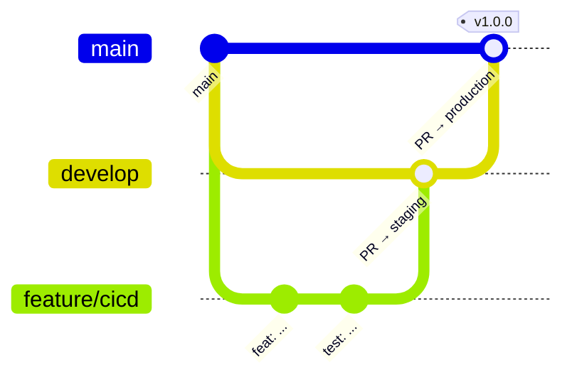
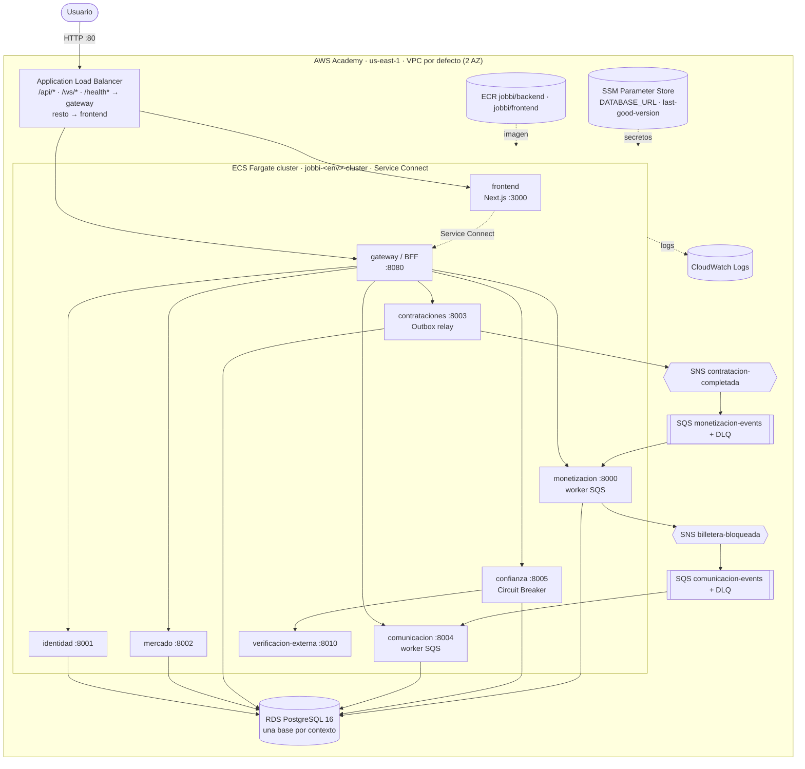

# CI/CD de JOBBI en AWS (ECS Fargate)

JOBBI es un marketplace que conecta a quien necesita un oficio (demandante)
con quien lo presta (prestador). Está hecho de microservicios FastAPI, uno
por contexto delimitado, detrás de un API Gateway/BFF, con un frontend
Next.js. La persistencia es PostgreSQL, con una base por contexto. La
mensajería asíncrona usa SNS/SQS con el patrón *Transactional Outbox*.

Este documento describe el pipeline que lo construye, prueba y despliega en
dos ambientes de AWS: **staging** y **production**.

## 1. Estrategia de ramificación: GitFlow simplificado



| Rama / evento | Workflow | Qué se ejecuta |
|---|---|---|
| PR `feature/*` → `develop` | `ci.yml` | Solo los pipelines de los componentes que toca el PR (backend, frontend, infra), más Sonar. No publica nada. Required check: `ci-ok`. |
| push `develop` | `cd.yml` | Plan → pipelines de los componentes cambiados (CI + release a ECR) → deploy **staging** de esos componentes → E2E pre-prod → smoke → versión estable por componente. Si algo falla, rollback de lo desplegado. |
| PR `develop` → `main` | `ci.yml` | Igual que el primer PR (required check `ci-ok`). |
| push `main` | `cd.yml` | Plan → como las imágenes ya existen, se **promueven** las de staging sin rebuild → deploy **production** de los componentes cuya versión difiere (**backend con aprobación manual, frontend automático**) → smoke post-prod → tag `vX.Y.Z`. Si algo falla, rollback de lo desplegado. |
| manual | `rollback.yml` | **Botón de pánico**: ambiente + componente (backend, frontend o ambos); vuelve a la última versión buena o a una versión dada. |
| manual | `destroy.yml` | Destruye un ambiente para ahorrar presupuesto del Learner Lab. |

**Por qué GitFlow simplificado (sin ramas `release/*` ni `hotfix/*`):**

- **Cada rama de larga vida es un ambiente:** `develop` = staging y `main` = production. El estado de cada ambiente se lee en el historial de su rama.
- **La promoción a producción es explícita y auditable.** Pasa por un PR `develop → main`, un CI verde y, para el backend, la aprobación del environment `production-approval`.

**Entrega continua vs. despliegue continuo (por componente):**

| Componente | Estrategia en production | Environment de GitHub | Por qué |
|---|---|---|---|
| Backend | **Entrega continua**: la versión queda lista y un humano aprueba el despliegue | `production-approval` (required reviewers) | Maneja datos, dinero (billetera, cobros) y esquema de BD; un error tiene alto impacto y el rollback de datos no es trivial |
| Frontend | **Despliegue continuo**: sale a producción sin intervención si el CI y staging pasaron | `production` (sin reglas) | No tiene estado; el rollback es inmediato y el riesgo, bajo |
| Infra base | Aprobación solo si cambia `infra/base/`, es el primer despliegue o se fuerza | `production-approval` / `production` | Cambios de red o RDS pueden ser destructivos; un drift no previsto falla en vez de aplicarse |
| Staging | Despliegue continuo de todo | `staging` | Es el ambiente de validación |

El gate se define en GitHub (environments) y el pipeline elige el environment de cada job en el job `plan`. El rollback (automático y botón de pánico) no pide aprobación, para que sea inmediato; destruir production sí la pide.
- **Las features se integran a diario en `develop`.** Así se prueban juntas en staging antes de llegar a producción, cosa que GitHub Flow no ofrece cuando hay un solo ambiente intermedio.
- **Se descartan las ramas `release/*` y `hotfix/*` de GitFlow completo.** Para un equipo pequeño con despliegue continuo son burocracia. Un hotfix es un PR a `develop` que se promueve de inmediato.

**Versionamiento:**

- Cada **imagen** se etiqueta con el hash del árbol de **su carpeta**: `git rev-parse HEAD:services` para el backend y `HEAD:frontend` para el frontend. Si una carpeta no cambia, su tag tampoco, y el componente no se reconstruye ni se redespliega. El merge `develop → main` crea otro commit pero conserva los mismos árboles. Por eso producción despliega exactamente las imágenes probadas en staging (*build once, deploy many*). Las imágenes de ECR son inmutables.
- Los **releases** usan versión semántica: el archivo `VERSION` produce el tag `vX.Y.Z` al desplegar con éxito en producción.

## 2. Diseño del pipeline

El pipeline está separado **por componente**. Un orquestador (`cd.yml` en push, `ci.yml` en PR) decide qué componentes cambiaron y ejecuta solo sus pipelines:

| Workflow | Tipo | Contenido |
|---|---|---|
| `ci.yml` | Orquestador de PR | `changes` (diff contra la rama base) → pipelines afectados + `quality` → `ci-ok` (único required check) |
| `cd.yml` | Orquestador de push | `plan` → pipelines → `deploy-infra` → `deploy-backend` → `deploy-frontend` → pruebas → estable / rollback |
| `pipeline-backend.yml` | Reutilizable | CI + release del backend (`services/`) |
| `pipeline-frontend.yml` | Reutilizable | CI + release del frontend (`frontend/`) |
| `pipeline-infra.yml` | Reutilizable | Validación y SAST de la IaC (`infra/`, `ci/`) |
| `quality.yml` | Reutilizable | SonarCloud sobre todo el repositorio (corre siempre) |
| `deploy-component.yml` | Reutilizable | Deploy App de un componente (su capa de Terraform + espera de versión) |
| `rollback.yml` | Reutilizable + manual | Rollback por componente (automático y botón de pánico) |
| `.github/actions/integration-tests` | Acción compuesta | Ambiente efímero de `ci/` + E2E y smoke (la usan ambos pipelines) |
| `.github/actions/release-image` | Acción compuesta | ECR (`infra/shared`) + push inmutable (la usan ambos pipelines) |

```mermaid
flowchart TB
  PUSH([push develop / main]) --> PLAN[plan<br/><i>versión deseada vs. desplegada (SSM)<br/>imagen ya en ECR?</i>]

  subgraph PB["pipeline-backend.yml · si cambió services/"]
    direction TB
    B1[Estáticas<br/><i>Ruff + Bandit</i>] & B2[SAST · SCA<br/><i>Fluid Attacks</i>] & B3[Unitarias + cobertura<br/><i>pytest ≥65 %</i>]
    B1 & B3 --> B4[Build + integración<br/><i>Buildx · docker compose</i>]
    B4 & B2 --> B5[Release<br/><i>ECR inmutable</i>]
  end

  subgraph PF["pipeline-frontend.yml · si cambió frontend/"]
    direction TB
    F1[Estáticas<br/><i>ESLint · tsc · next build</i>] & F2[SAST · SCA<br/><i>Fluid Attacks</i>]
    F1 --> F4[Build + integración<br/><i>Buildx · docker compose</i>]
    F4 & F2 --> F5[Release<br/><i>ECR inmutable</i>]
  end

  subgraph PI["pipeline-infra.yml · si cambió infra/ o ci/"]
    I1[terraform fmt/validate<br/>compose config] & I2[SAST IaC<br/><i>Fluid Attacks</i>]
  end

  Q[quality.yml<br/><i>SonarCloud quality gate</i>]

  PLAN --> PB & PF & PI & Q
  PB & PF & PI & Q --> DI[deploy-infra<br/><i>Terraform base · aprobación si cambia la base</i>]
  DI --> DB[deploy-backend<br/><i>infra/app-backend · 8 servicios<br/>PRD: aprobación manual</i>]
  DB --> DF[deploy-frontend<br/><i>infra/app-frontend<br/>PRD: automático</i>]
  DF --> PRE[tests-preprod<br/><i>E2E · solo staging</i>]
  PRE --> SM[smoke-tests<br/><i>versión de cada componente</i>]
  SM -->|ok| OK[mark-stable<br/><i>last-good por componente · tag vX.Y.Z</i>]
  SM -->|falla| RB[rollback<br/><i>solo componentes desplegados en el run</i>]
  PRE -->|falla| RB
  DB -->|falla| RB
  DF -->|falla| RB
  PANIC((Botón de pánico<br/>ambiente + componente)) --> RB
```

### Jobs y herramientas

| Etapa | Job | Herramientas | Falla si… |
|---|---|---|---|
| Checkout | todos | `actions/checkout` | — |
| Plan | `plan` (`cd.yml`), `changes` (`ci.yml`) | git (hash por carpeta, diff), SSM, ECR | — |
| Build | `static-analysis`, `unit-tests`, `build-and-integration` de cada pipeline | pip, pnpm, Docker Buildx (caché GHA por componente) | no compila o no instala |
| Test estático | `backend · static-analysis`, `frontend · static-analysis`, `infra · iac-validate` | Ruff (pycodestyle, pyflakes, isort, bugbear, **Bandit**); ESLint + `tsc --noEmit` + `next build`; `terraform fmt/validate` (4 raíces) + `docker compose config` | hay un error de lint, de tipos o de IaC |
| Test de seguridad | `security-sast`, `security-sca` de cada pipeline | **Fluid Attacks** SAST y SCA acotados a cada componente (`.fluid/*.yaml`), SARIF en GitHub Security | hay hallazgos de severidad alta o crítica (modo `diff` en PR, `full` en push) |
| Test unitario + cobertura | `backend · unit-tests` | pytest (246 pruebas), pytest-cov (líneas + ramas) | alguna prueba falla o la cobertura queda por debajo de 65 % |
| Calidad | `quality · sonarcloud` | SonarCloud (quality gate) | no se cumple el quality gate |
| Test de integración | `build-and-integration` de cada pipeline | Acción `integration-tests`: docker compose (nginx como ALB, PostgreSQL 16, LocalStack SNS/SQS, núcleo de servicios) + pytest E2E y smoke | algún flujo falla con las imágenes reales |
| Release | `release` de cada pipeline | Acción `release-image`: Terraform (`infra/shared`: ECR), `amazon-ecr-login`, `docker push` | la publicación falla |
| IaC + Deploy Infra | `deploy-infra` | Terraform `infra/base` (plan `-detailed-exitcode`; solo aplica si hay cambios) | el plan o el apply fallan |
| Deploy App | `deploy-backend`, `deploy-frontend` (`deploy-component.yml`) | Terraform `infra/app-backend` / `infra/app-frontend`, ECS rolling update con *circuit breaker*, SSM `current-version`, `scripts/esperar-version.sh` | las tareas no quedan sanas o no se sirve la versión nueva |
| Tests pre-prod | `tests-preprod` | pytest + requests contra el ALB de staging | el flujo E2E falla |
| Tests post-prod | `smoke-tests` | pytest + requests contra el ALB (versión esperada por componente) | el ambiente no está sano |
| Rollback | `rollback` (`rollback.yml`) | SSM `last-good-version` por componente, Terraform de la capa del componente, smoke | — |

### Pipelines independientes por componente

**Cómo se decide qué corre:**

- **En un PR**, el job `changes` mira el diff contra la rama base:

  | Ruta | Pipeline |
  |---|---|
  | `services/**` | backend |
  | `frontend/**` | frontend |
  | `infra/**` | infra |
  | `ci/**`, `tests/**`, `.github/**` | backend + frontend (+ infra para `ci/` y `.github/`) |

- **En un push**, el job `plan` compara, para cada componente, la **versión deseada** (hash de su carpeta) con la **versión desplegada** (SSM `/jobbi/<env>/<componente>/current-version`):
  - Si **la imagen no existe en ECR**, corre su pipeline (CI + release).
  - Si **la versión difiere** (o cambió `infra/app-<componente>/`), se despliega.
  - Si **es igual**, no se toca.

  Comparar contra lo desplegado, en vez de solo contra el diff, hace que la promoción a `main` despliegue exactamente lo que cambió desde la última promoción. También funciona después de un rollback.

**Beneficios:**

- **Ciclos más cortos:** un cambio de UI no espera los 246 tests del backend ni el reemplazo de sus 8 tareas.
- **Menor radio de impacto:** desplegar un componente no reinicia el otro.
- **Rollback independiente:** solo se revierte lo que se desplegó en el run que falló.
- **Cadencias independientes:** se pueden sacar hotfixes del backend sin tocar el frontend.
- **Coherencia con microservicios:** cada componente es desplegable de forma independiente.

**Reglas que esto exige:**

- **Contrato `/api` retrocompatible** (patrón *expand/contract*). Si cambian ambos componentes, el backend se despliega primero, para que el frontend nuevo encuentre la API nueva.
- **El E2E de staging corre completo siempre:** valida la combinación de versiones que quedó desplegada.

**Casos de despliegue:**

| Caso | Pipelines que corren | Qué se despliega | Rollback si algo falla |
|---|---|---|---|
| Solo `frontend/` | frontend + quality | 1 servicio (frontend) | Solo el frontend |
| Solo `services/` | backend + quality | 8 servicios del backend | Solo el backend |
| Ambos | backend + frontend + quality | Backend y luego frontend | Los dos, cada uno a su `last-good-version` |
| Solo `infra/base/` | infra + quality | Infraestructura base (sin redeploy de app) | No aplica: el plan/apply falla antes |
| Solo `tests/` o `ci/` | (en el PR: ambos pipelines) | Nada en push: las imágenes no cambian | — |
| Solo `docs/` o `*.md` | Ninguno (`paths-ignore`) | — | — |
| Promoción `develop → main` | Ninguno de build (imágenes ya en ECR) + quality | Los componentes cuya versión difiere de producción | Por componente |
| Botón de pánico | `rollback.yml` | El componente elegido (o ambos) | — |
| Ejecución manual de `cd.yml` con `forzar` | Los que falten en ECR | Ambos componentes | Ambos |

**Evolución posible:** separar cada microservicio del backend en su propio pipeline. Hoy no aporta, porque comparten una imagen y `services/common/`. Tendría sentido si cada contexto tuviera su propia imagen y su propio ciclo de versiones.

## 3. Arquitectura en AWS



| Componente | Servicio AWS | Notas |
|---|---|---|
| Registro de imágenes | **ECR** (`infra/shared`) | Dos repositorios compartidos por los ambientes. Tags inmutables, `scan_on_push`, retención de 30 imágenes. |
| Cómputo | **ECS Fargate** (`infra/app-backend`, `infra/app-frontend`) | 9 servicios por ambiente: 8 del backend (un contexto por servicio, misma imagen, distinto `SERVICE_MODULE`) y el frontend. Cada capa se despliega por separado. |
| Descubrimiento | **ECS Service Connect** (Cloud Map) | Los servicios se llaman `http://identidad:8001`, igual que en Kubernetes. |
| Entrada | **ALB** | Ruteo por ruta: el navegador solo conoce un origen. *Stickiness* para el WebSocket del chat. |
| Datos | **RDS PostgreSQL 16** | Una instancia por ambiente y una base por contexto, creada por el servicio al arrancar. |
| Mensajería | **SNS + SQS + DLQ** | Outbox → SNS → SQS → worker, con política de cola y *redrive* a la DLQ tras 5 fallos. |
| Secretos | **SSM Parameter Store** | `DATABASE_URL` como SecureString, inyectado por ECS. |
| Estado del pipeline | **SSM** `/jobbi/<env>/<componente>/current-version` y `.../last-good-version` | Qué está desplegado (decide qué desplegar) y punto de retorno del rollback, por componente. |
| Estado de Terraform | **S3** con lockfile | Workspaces `staging`/`production`, separados en cuatro estados: shared, base, app-backend y app-frontend. |
| Permisos | **LabRole** | AWS Academy no permite crear roles IAM. |

**Diferencias con la versión local (Minikube):**
- LocalStack se reemplaza por SNS/SQS reales (`AWS_PROVEEDOR=aws`, credenciales del rol de la tarea).
- El StatefulSet de PostgreSQL se reemplaza por RDS.
- Los Service de Kubernetes se reemplazan por Service Connect.
- Prometheus/Grafana se reemplazan por CloudWatch (Container Insights).

**Alcance en AWS (núcleo):**
- Se despliegan gateway, identidad, mercado, contrataciones, comunicacion, confianza, monetizacion, verificacion-externa y frontend. Es todo lo necesario para el flujo de contratación con cobro por eventos.
- No se despliegan soporte, adquisicion, proteccion ni escalador_bd (este último es específico de Kubernetes). El gateway responde 502 controlado para sus rutas.

## 4. Pruebas

| Prueba | Dónde corre | Qué valida | Por qué |
|---|---|---|---|
| Ruff + Bandit | CI | Estilo, errores (pyflakes), imports y reglas de seguridad del código Python | Detecta defectos baratos antes de ejecutar nada |
| ESLint + `tsc` | CI | Reglas de React/Next y tipos del frontend | El build de Next ignora errores de tipos (`ignoreBuildErrors`); esta es la red |
| `terraform validate` / `fmt` | CI | Sintaxis y coherencia de la IaC de las cuatro capas | Un error de IaC no debe descubrirse en el apply |
| Fluid Attacks SAST | CI | Vulnerabilidades en el código: inyección, secretos, configuraciones inseguras | Seguridad desplazada a la izquierda (*shift-left*) |
| Fluid Attacks SCA | CI | Dependencias pip/pnpm con CVE conocidos | La mayor parte del código que corre es de terceros |
| pytest (246) + cobertura | CI (SQLite, sin AWS) | Reglas de negocio RN-01…RN-10, outbox, workers SQS, circuit breaker, reintentos, proxy del gateway, chat WebSocket y configuración de despliegue | Rápidas y deterministas; cubren la lógica sin infraestructura |
| SonarCloud | CI | Code smells, duplicación, cobertura del código nuevo | Calidad sostenida en el tiempo |
| Integración de contenedores | CI (docker compose) | Las **imágenes reales** con PostgreSQL, SNS/SQS (LocalStack) y ruteo tipo ALB; corre las mismas suites E2E y smoke | Detecta errores de empaquetado y configuración antes de gastar en AWS |
| E2E de aceptación | **Staging** (pre-prod) | El flujo completo: registro → verificación → oferta → contacto + chat → acuerdo → check-in/out → **cobro por Outbox → SNS → SQS** sobre la infraestructura real | Es la prueba de que la versión funciona en AWS antes de pedir aprobación |
| Smoke | **Staging y production** (post-deploy) y después de cada rollback | Frontend y gateway arriba, cada uno con **su versión esperada** (`EXPECTED_FRONTEND_VERSION`, `EXPECTED_BACKEND_VERSION`), todos los contextos alcanzables por Service Connect, una lectura de RDS | Es rápida y no crea datos; si falla, dispara el rollback |

## 5. Rollback

El rollback es **por componente**: backend y frontend tienen cada uno su `last-good-version` y su capa de Terraform.

1. **ECS deployment circuit breaker (plataforma).** Si las tareas nuevas no quedan sanas, ECS vuelve solo a la revisión anterior y el job `deploy-<componente>` falla.
2. **Rollback automático (pipeline).** Si fallan `deploy-backend`, `deploy-frontend`, `tests-preprod` o `smoke-tests`, el job `rollback` llama a `rollback.yml` con **solo los componentes que se desplegaron en ese run**. Si únicamente cambió el frontend, el backend no se toca. Para cada componente, en paralelo:
   1. lee `/jobbi/<env>/<componente>/last-good-version` de SSM y comprueba que la imagen exista en ECR;
   2. re-aplica **solo** `infra/app-<componente>` con ese tag y actualiza `current-version`;
   3. espera a que se sirva la versión restaurada.

   Al final corre el smoke del ambiente completo con la versión vigente de cada componente.
3. **Botón de pánico (manual).** En *Actions → Rollback → Run workflow* se elige ambiente y componente (`backend`, `frontend` o `ambos`) y, para un solo componente, opcionalmente una versión. Hace el mismo procedimiento sin esperar a que nada falle.

`last-good-version` solo se actualiza (job `mark-stable`) cuando el smoke pasa, y solo para los componentes desplegados en ese run. Por eso siempre apunta a una versión verificada.

## 6. Puesta en marcha (una vez)

1. **Credenciales del Learner Lab.** En *AWS Details* copia `aws_access_key_id`, `aws_secret_access_key` y `aws_session_token`. Caducan con cada sesión, así que hay que actualizar los secrets al iniciar una sesión.
2. **Bucket del estado:** `./scripts/bootstrap-tfstate.sh`. Si el nombre ya está tomado, cámbialo en `infra/backend.hcl` y en `TF_STATE_BUCKET` de los workflows.
3. **Secrets del repositorio** (*Settings → Secrets and variables → Actions*):
   - `AWS_ACCESS_KEY_ID`, `AWS_SECRET_ACCESS_KEY`, `AWS_SESSION_TOKEN`
   - `SONAR_TOKEN`: crea el proyecto `mateomunozb_jobbi` en sonarcloud.io y desactiva su *Automatic Analysis*.
4. **Environments** (*Settings → Environments*):
   - `staging`: sin reviewers; *Deployment branches* = `develop`.
   - `production`: **sin reviewers** (despliegue continuo del frontend); *Deployment branches* = `main`.
   - `production-approval`: **Required reviewers** (entrega continua del backend, cambios de la base y destroy); *Deployment branches* = `main`. Sin *Prevent self-review* si eres el único revisor.
   - Si un despliegue del backend no debe salir, **cancela el run** en vez de rechazarlo: un rechazo cuenta como fallo y dispara el rollback automático (inofensivo, pero ensucia la evidencia).
5. **Protección de ramas** en `main` y `develop`:
   - Exigir PR.
   - Required check: **`ci-ok`**. Resume el resultado de los pipelines que corrieron; los omitidos por no tener cambios no bloquean.
6. **Primer despliegue.** El primer push a `develop` construye ambos componentes, crea ECR, la capa base (RDS tarda unos 10 min) y las dos capas de app. Mientras no exista una versión buena, un fallo no tiene a dónde volver: el rollback lo informa y termina en error.

## 7. Comandos útiles

```bash
# CI local
cd services && python -m pytest --cov-fail-under=65 && ruff check .
cd frontend && pnpm lint && pnpm typecheck
for r in shared base app-backend app-frontend; do terraform -chdir=infra/$r validate; done

# Regenerar los lock files con hashes (tras cambiar requirements*.txt o tests/requirements.in);
# el pipeline instala con --only-binary :all: --require-hashes
uv pip compile services/requirements-dev.txt --universal --generate-hashes --python-version 3.11 --only-binary :all: --no-header -o services/requirements-dev.lock
uv pip compile tests/requirements.in --universal --generate-hashes --python-version 3.11 --only-binary :all: --no-header -o tests/requirements.lock

# Ambiente de integración local (requiere Docker)
docker build -t jobbi/backend:ci services
docker build -t jobbi/frontend:ci --build-arg API_GATEWAY_URL=http://gateway:8080 frontend
export CI_DB_PASSWORD=$(openssl rand -hex 16)   # contraseña efímera de la PostgreSQL de CI
docker compose -f ci/docker-compose.ci.yml up -d --wait
APP_BASE_URL=http://localhost:8088 python -m pytest tests/e2e tests/smoke -v
docker compose -f ci/docker-compose.ci.yml down -v
```
